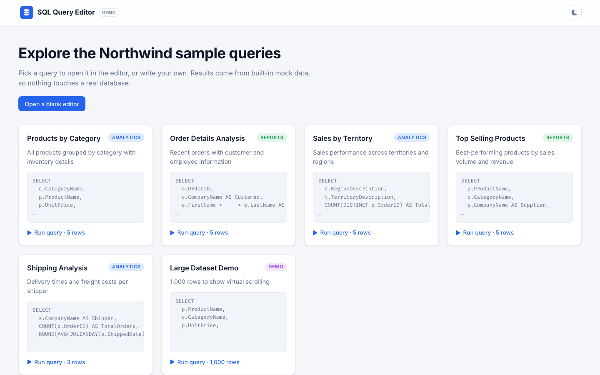
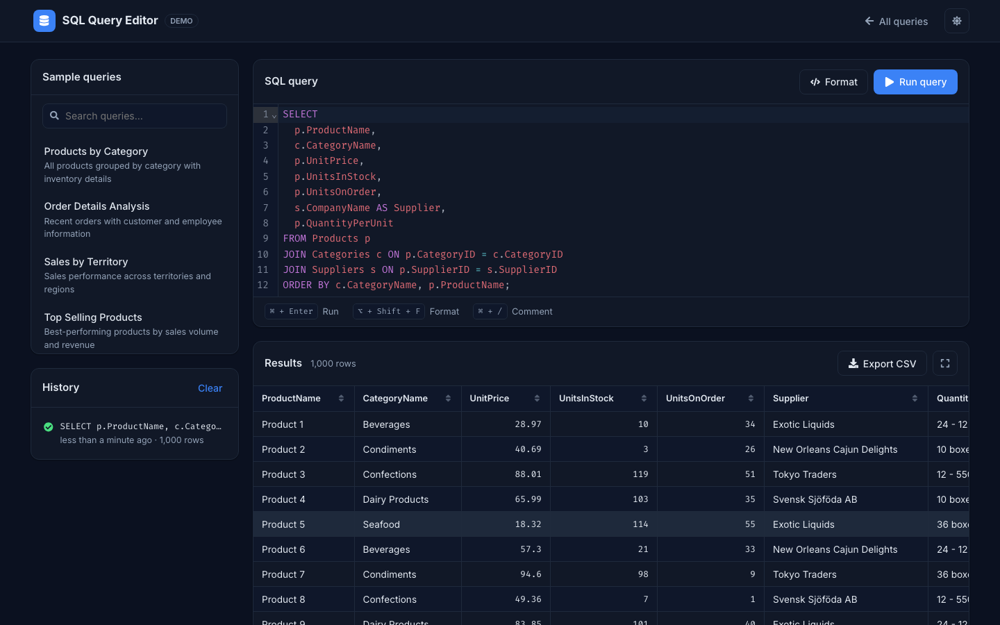
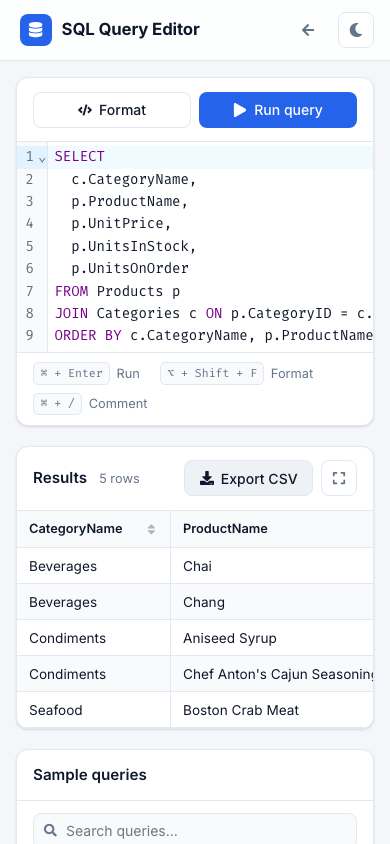

# SQL Query Editor

A browser-based SQL editor demo built with React, Vite and CodeMirror. It has syntax highlighting, query formatting, a virtualized results table, query history and CSV export.


[](https://github.com/VamsiKrishnaThota03/sql-query-editor/actions/workflows/ci.yml)
[](https://github.com/VamsiKrishnaThota03/sql-query-editor/actions/workflows/codeql.yml)
[](LICENSE)

## Live demo

**https://sql-query-editor-fawn.vercel.app**

| Query library | Editor with 1,000-row result (dark) | Mobile |
| --- | --- | --- |
|  |  |  |

## Overview

This is a **frontend-only** project for exploring a SQL editing workflow in the browser. There is no database connection. Queries run against built-in mock datasets modeled on the Northwind sample schema (Products, Categories, Orders, Customers, Territories, Shippers):

- Picking one of the predefined queries (or typing one exactly) returns its sample result set.
- Any other query is checked for basic `SELECT ... FROM ...` syntax and matched by keyword (products/categories, orders, customers, territories/regions, shippers/freight) to a mock table, after a short simulated delay. A single `WHERE column = 'value'` equality filter and `LIMIT n` are applied. See [Technical notes](docs/TECHNICAL.md).

## Features

- **SQL editor:** CodeMirror 6 with SQL syntax highlighting (`@uiw/react-codemirror`, `@codemirror/lang-sql`)
- **Format button:** pretty-prints the query with `sql-formatter` (keywords upper-cased)
- **Keyboard shortcuts:** Ctrl/⌘ + Enter runs the query, Alt/⌥ + Shift + F formats it
- **Predefined query library:** six sample queries in the analytics, reports and demo categories, with a search box
- **Query validation:** rejects empty queries, comment-only input and statements that are not `SELECT ... FROM ...`
- **Results table:**
  - virtualized rows with `react-window` (`FixedSizeList`); the "Large Dataset Demo" query renders 1,000 generated rows
  - fixed header; click a column to sort ascending, descending or unsorted; drag a header edge to resize
  - number, string and `NULL` formatting, row count and timing
  - full-screen view (Esc to close) and CSV export of the current sort order (`react-csv`)
- **Query history:** the last 20 runs, with success/failure status, relative time (`date-fns`) and row count, saved to `localStorage`. Click an entry to run it again, or clear the list.
- **Light/dark theme:** defaults to the OS preference and is saved to `localStorage`
- **Responsive layout** with keyboard-accessible cards, lists and buttons
- **Code splitting:** the CodeMirror editor is lazy-loaded when the editor opens

## Tech stack

| Area | Tools |
| --- | --- |
| Framework | React 18, Vite 5 |
| Editor | `@uiw/react-codemirror`, `@codemirror/lang-sql`, `sql-formatter` |
| Results | `react-window`, `react-csv` |
| Utilities | `date-fns`, `react-icons` |
| Tooling | ESLint, `node:test` |
| Hosting | Vercel (SPA rewrite in `vercel.json`) |

## Project structure

```
sql-query-editor/
├── docs/
│   ├── ARCHITECTURE.md     # component overview
│   └── TECHNICAL.md        # implementation notes
├── src/
│   ├── App.jsx             # app state, history, view switching
│   ├── data/queries.js     # predefined queries + mock datasets
│   ├── lib/mockEngine.js   # validation and mock execution (+ tests)
│   ├── components/
│   │   ├── QueryEditor.jsx     # CodeMirror editor + run / format buttons
│   │   ├── QuerySelector.jsx   # searchable predefined query list
│   │   ├── ResultsTable.jsx    # virtualized, sortable table + CSV export
│   │   ├── QueryHistory.jsx    # recent queries with timestamps
│   │   └── Navbar.jsx          # navigation + theme toggle
│   └── main.jsx
├── vercel.json
└── vite.config.js
```

## Getting started

### Prerequisites

- Node.js 18 or later and npm

### Install and run

```bash
git clone https://github.com/VamsiKrishnaThota03/sql-query-editor.git
cd sql-query-editor
npm install
npm run dev
```

### Scripts

| Command | Description |
| --- | --- |
| `npm run dev` | Start the Vite dev server |
| `npm run build` | Production build into `dist/` |
| `npm run preview` | Serve the production build locally |
| `npm run lint` | Run ESLint |
| `npm test` | Run the mock-engine unit tests (`node --test`) |

There are no environment variables to set.

## Known limitations

- Queries never reach a database; only the patterns described above return data.
- Only one `WHERE` equality condition is understood; `JOIN`, `GROUP BY` and `ORDER BY` in typed queries do not change the mock results.
- The editor chunk (CodeMirror) is still about 650 kB minified, loaded on first use.

## Documentation

- [Architecture](docs/ARCHITECTURE.md)
- [Technical notes](docs/TECHNICAL.md)

## Contact

Questions or feedback: vamsikrishnathota483@gmail.com


## Tests

```bash
npm run test:run       # 29 tests
npm run test:coverage
```

The `test` script was `node --test src/lib/`, which does not work on Node 20+ —
passing a directory makes the runner try to `require` it as a module, so the
suite had been failing with `MODULE_NOT_FOUND` rather than running. It now uses
Vitest, which also makes component tests possible.

The 6 existing engine assertions were kept and expanded to 22, covering:
comment stripping (including multi-line block comments), every rejection path
in `validateQuery` (empty, comments-only, `DELETE`/`DROP`/`UPDATE`/`INSERT`,
and a bare `SELECT 1`), every predefined query returning its own result set
verbatim, predefined matching surviving comments/casing/a trailing semicolon,
the 1,000-row dataset staying rectangular — the virtualised grid assumes one
cell per column, so a ragged row would render as a shifted column rather than
an error — `WHERE` equality being case-insensitive and accepting single-quoted,
double-quoted and numeric values, an unknown `WHERE` column returning
everything rather than silently returning nothing, `LIMIT`, the two combined,
keyword routing to each table, and that repeated queries never mutate the
underlying mock tables.

7 component tests cover `ResultsTable`: headers rendering, the row count, an
empty result set not throwing, the CSV download link, sort controls, and that
cell values are rendered as text rather than markup. That last one guards
against anyone introducing `dangerouslySetInnerHTML` on the cell path — the mock
data is static today, but a real engine's output would not be.

## Security headers

This is a static SPA with no backend and no secrets: the SQL is never executed,
and the Northwind-style data is bundled. The headers therefore live in
`vercel.json` rather than in server code — a CSP plus `nosniff`,
`strict-origin-when-cross-origin`, `X-Frame-Options: DENY`, HSTS and a
`Permissions-Policy` denying camera, microphone and geolocation.

`script-src` is `'self'` with no `'unsafe-inline'`. `style-src` does need it,
because CodeMirror sets inline styles on its editor DOM; that is noted in the
config rather than left unexplained. `form-action` is `'none'` since the app
submits nothing anywhere.

## Build

The Vite dev server binds `127.0.0.1` explicitly, so it is never reachable from
the local network — use `npm run dev -- --host` deliberately if you want to
share it.

CodeMirror (420 kB), sql-formatter (235 kB) and the grid libraries are split
into their own chunks, leaving app code at 175 kB. Those three change far less
often than the app, so shipping a UI tweak no longer invalidates the whole
vendor payload in users' caches. CI asserts the chunks are still being emitted,
since losing the `manualChunks` config would silently undo it.

## Continuous integration

| Job | What it proves |
| --- | --- |
| `test` (Node 20, 22) | ESLint and 29 tests, plus coverage on 20 |
| `build` | A production build; that the `editor`, `formatter` and `grid` vendor chunks are still emitted; and that `vercel.json` is valid JSON with the security headers intact |

CodeQL runs weekly and on every push; Dependabot groups weekly patch/minor bumps.
